# 二手数码产品信息发布与交流平台

基于 **Spring Boot 3 + Vue 3** 的前后端分离项目，面向校园/社区的二手数码产品（手机、电脑、平板、相机、耳机等）信息发布与交流场景。

## 技术栈

| 层次 | 技术 | 版本 |
| --- | --- | --- |
| 后端框架 | Spring Boot | 3.2.5 |
| JDK | OpenJDK | 17 |
| 持久层 | MyBatis-Plus | 3.5.5 |
| 数据库 | MySQL | 8.0 |
| 缓存 | Redis | 7.x |
| 鉴权 | JWT (jjwt) | 0.12.5 |
| 接口文档 | Knife4j (OpenAPI 3) | 4.5.0 |
| 工具库 | Hutool | 5.8.27 |
| 前端框架 | Vue | 3.4 |
| 构建工具 | Vite | 5.x |
| UI 组件 | Element Plus | 2.x |
| 状态管理 | Pinia | 2.x |

## 界面预览

> 以下截图均来自 `sql/demo-data.sql` 导入的演示数据。

**首页与商品列表**

<p>
  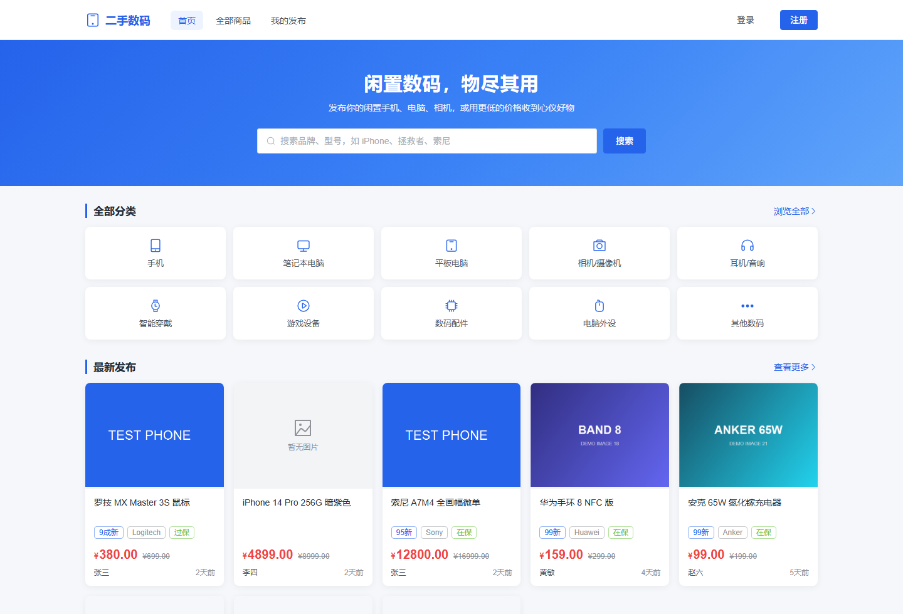
  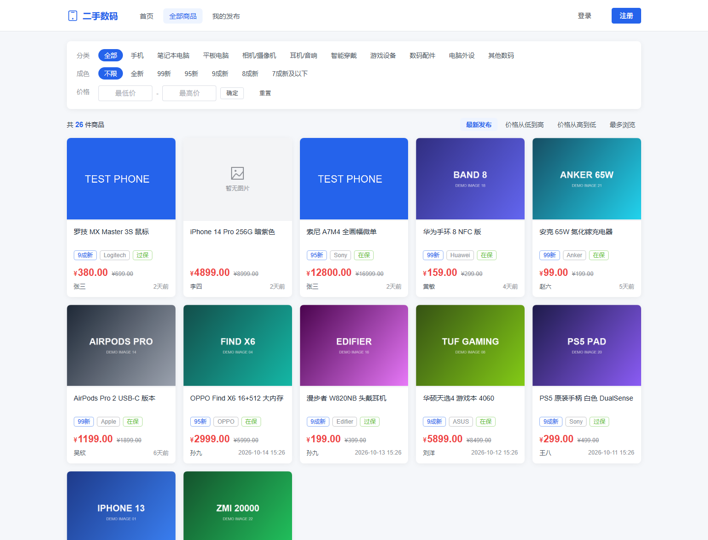
</p>

**商品详情与卖家主页**

<p>
  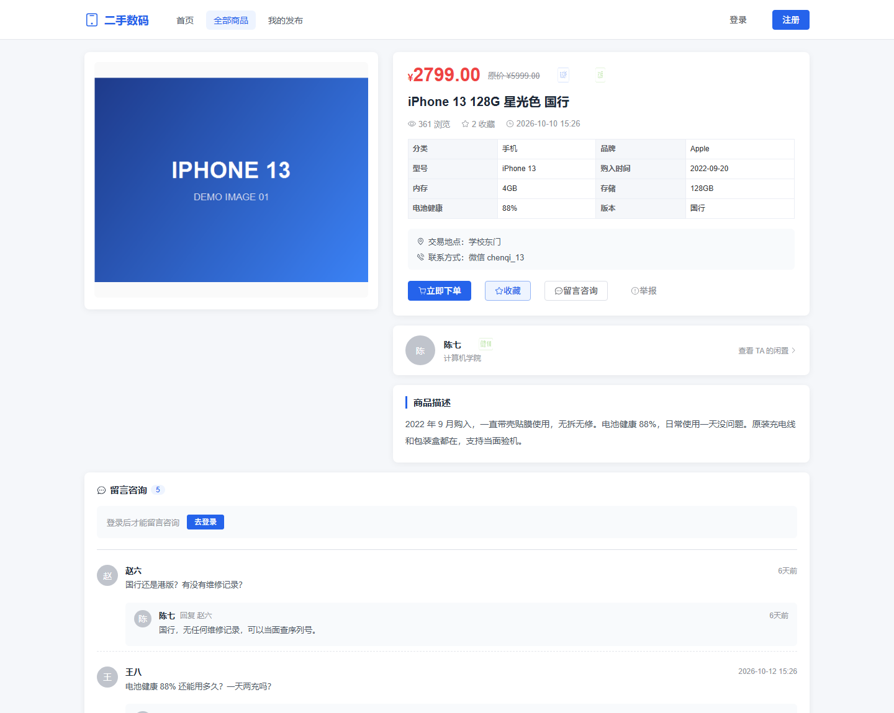
  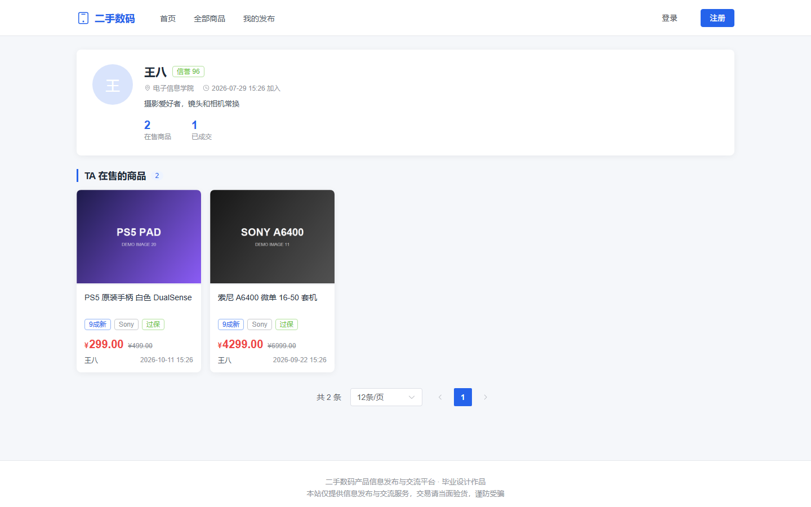
</p>

**发布商品与我的发布**

<p>
  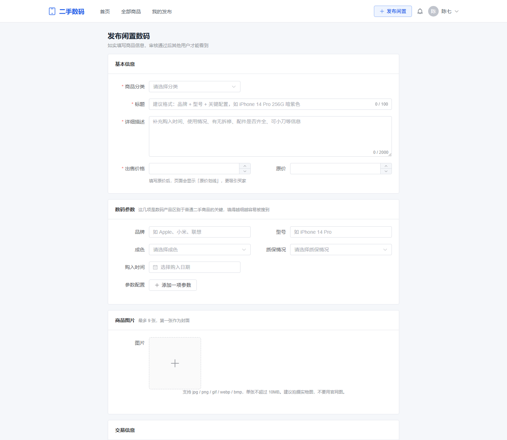
  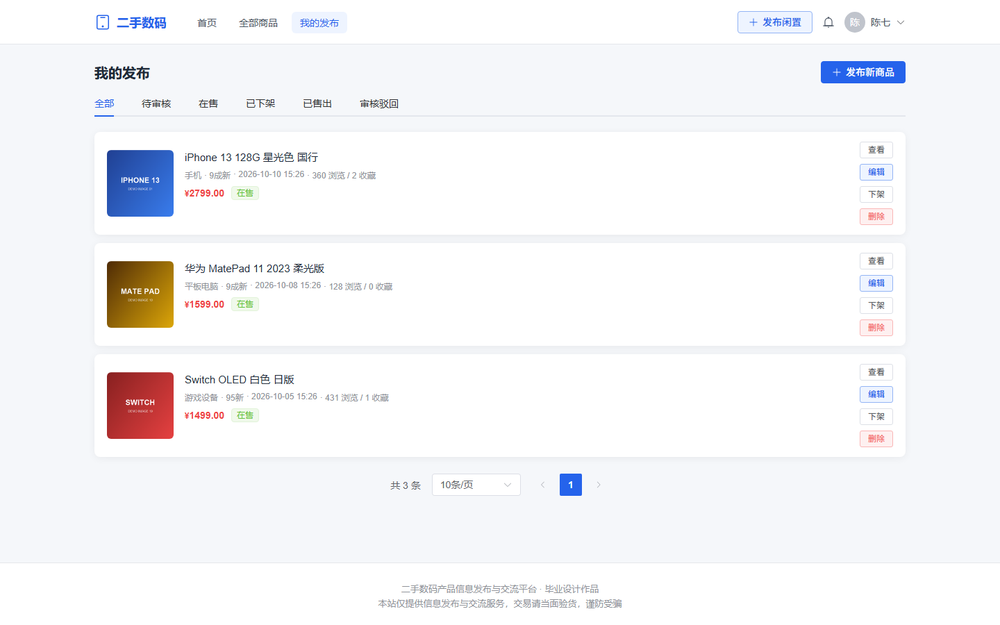
</p>

**我的订单与登录页**

<p>
  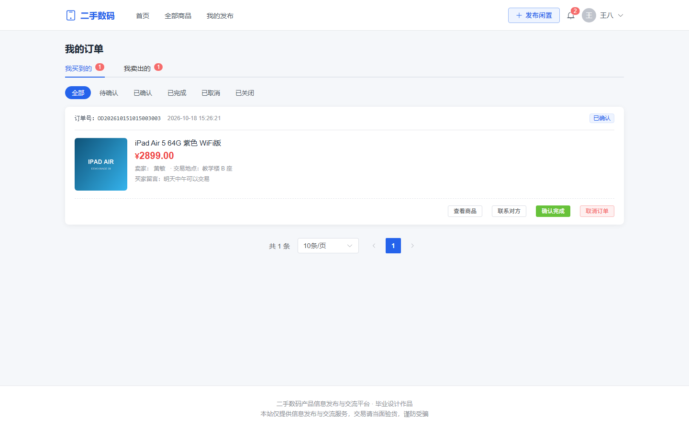
  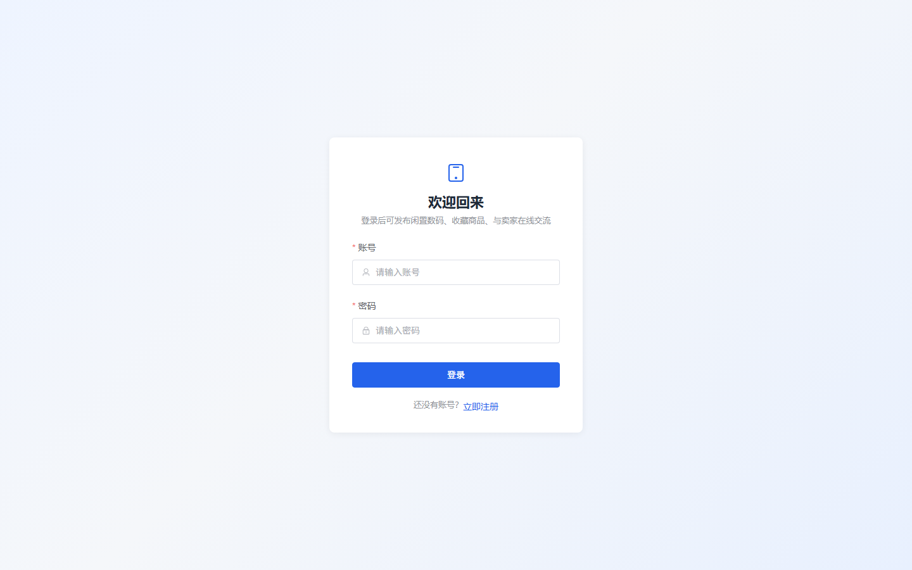
</p>

**管理后台：数据看板与商品审核**

<p>
  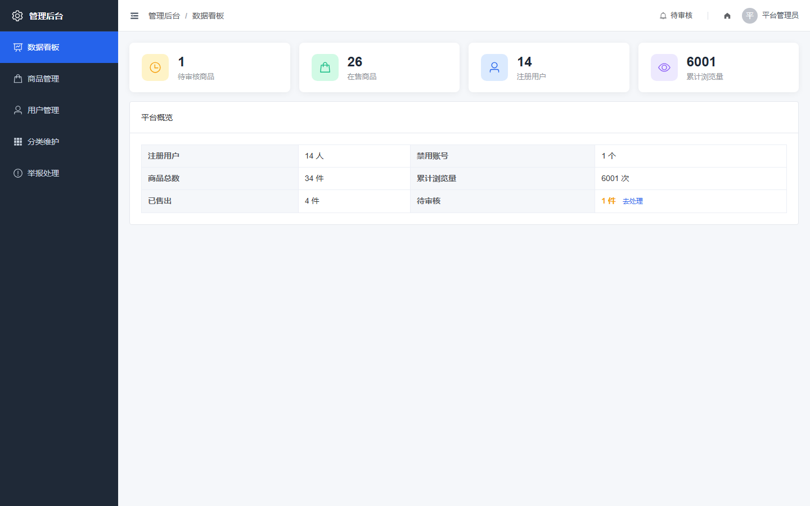
  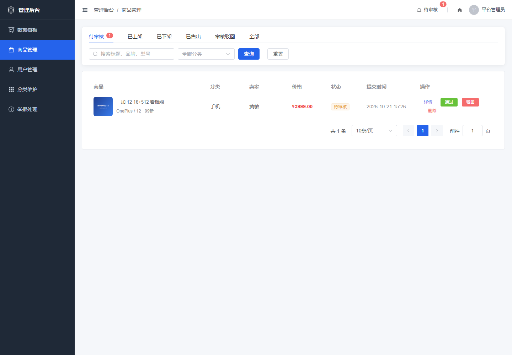
</p>

**管理后台：举报处理**

<p>
  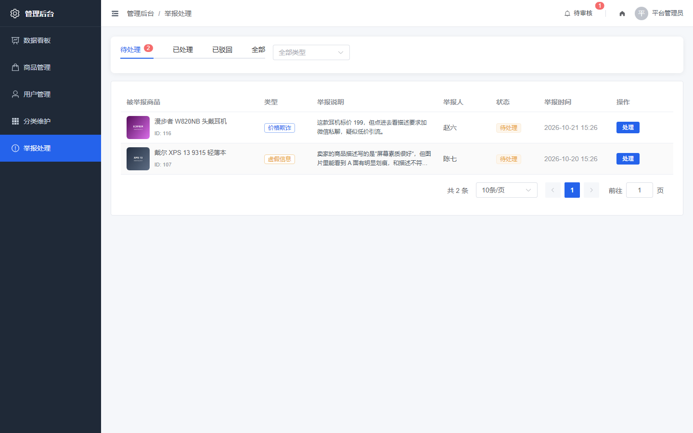
</p>

## 目录结构

```
used-digital-platform/
├── docs/                       # 开发文档
├── sql/                        # 数据库脚本（容器首次启动会自动执行）
├── backend/                    # Spring Boot 后端服务（含 Dockerfile）
├── frontend/                   # Vue 3 前端应用（含 Dockerfile + nginx.conf）
├── .github/workflows/ci.yml    # CI 流水线
├── docker-compose.yml          # 四服务编排
└── .env.example                # 部署参数模板
```

## 开发文档

| 文档 | 内容 |
| --- | --- |
| [01-开发路线图](docs/01-开发路线图.md) | 五个阶段的任务清单、进度与关键设计约定 |
| [02-地基原理讲解](docs/02-地基原理讲解.md) | 后端骨架、数据库连接、前端骨架的原理剖析 |
| [03-商品模块实现讲解](docs/03-商品模块实现讲解.md) | 分类、文件上传、商品发布/检索/详情的完整实现与安全设计 |
| [04-管理后台与商品审核实现讲解](docs/04-管理后台与商品审核实现讲解.md) | 权限隔离、审核事务、审核留痕、站内通知，含一次完整的 bug 排查实录 |
| [05-管理后台用户与分类模块实现讲解](docs/05-管理后台用户与分类模块实现讲解.md) | 管理操作的防呆设计、引用检查，以及 JWT 无状态特性的安全盲区修复 |
| [06-收藏与留言模块实现讲解](docs/06-收藏与留言模块实现讲解.md) | 计数一致性、两级留言树的归并设计、N+1 优化，含异常分类补丁 |
| [07-订单模块实现讲解](docs/07-订单模块实现讲解.md) | 订单快照、状态机与双视角权限、平台联动关闭订单 |
| [08-举报模块实现讲解](docs/08-举报模块实现讲解.md) | 分类驱动的处理流程、能力复用及其副作用、一次真实的 bug 修复 |
| [09-演示数据与系统自检](docs/09-演示数据与系统自检.md) | 演示数据设计、38 项功能自检清单、答辩演示脚本 |
| [10-卖家主页实现讲解](docs/10-卖家主页实现讲解.md) | 公开资料与私有资料的边界、查询复用与参数覆盖、事件冒泡 |
| [11-Redis缓存实现讲解](docs/11-Redis缓存实现讲解.md) | 缓存穿透/雪崩/一致性、浏览量计数回写、降级设计、压测方法与真实数据 |
| [12-部署与运维](docs/12-部署与运维.md) | 多阶段构建、compose 编排、nginx 配置、日志规范、健康检查、CI |

## 容器化部署（推荐）

只需要 Docker，不用在本机装 MySQL / Redis / JDK / Maven / Node。

```bash
cp .env.example .env          # 按需修改密码与密钥
docker compose up -d --build  # 构建并启动四个服务
```

浏览器打开 <http://localhost>（端口被占用时改 `.env` 里的 `WEB_PORT`）。

```
浏览器 ──:80──▶ frontend (nginx)
                  ├── /         前端静态文件 + SPA 路由回退
                  ├── /api/     反向代理 ──▶ backend:8080
                  └── /uploads/ 反向代理 ──▶ backend:8080

                    backend ──┬──▶ mysql:3306   （命名卷持久化）
                              └──▶ redis:6379   （挂了自动降级查库）
```

**只有 nginx 对外暴露端口**，MySQL / Redis / 后端都在内网，不会占用宿主机的
3306 / 6379 / 8080。

常用命令：

```bash
docker compose ps                  # 看状态与健康检查
docker compose logs -f backend     # 跟后端日志
docker compose down                # 停止（保留数据）
docker compose down -v             # 停止并清空数据（慎用）
```

更多细节见 [12-部署与运维](docs/12-部署与运维.md)。

## 快速开始（本地开发）

### 1. 准备数据库

```bash
mysql -uroot -p < sql/init.sql
```

脚本会创建数据库 `used_digital_platform`、全部数据表以及分类等字典数据。

**（可选，推荐）导入演示数据**：

```bash
mysql -uroot -p --default-character-set=utf8mb4 used_digital_platform < sql/demo-data.sql
```

会填充 10 个演示用户、28 件商品、17 条收藏、15 条留言、6 个订单、4 条举报和 13 条站内通知，
覆盖在售 / 待审核 / 已售出 / 已下架 / 已驳回、订单五种状态、举报三种状态等所有场景，
答辩演示时各页面都有内容。所有演示账号密码均为 `123456`。

> 演示商品的图片由 `sql/demo-data.sql` 配套使用 `backend/uploads/demo/` 下的占位图，
> 重新导入时会自动覆盖旧的演示数据（只清理 id ≥ 100 的记录，不影响你手动创建的数据）。

### 2. 启动 Redis

商品详情、分类列表和浏览量都依赖 Redis（未启动时会自动降级为直接查库，功能不受影响，只是没有缓存收益）。

```bash
docker run -d --name udp-redis -p 6379:6379 redis:7-alpine
```

没有 Docker 的话，装一个 Memurai 或 Redis for Windows 也可以，默认连 `localhost:6379`。
连接信息在 `application.yml` 的 `spring.data.redis` 下，支持 `REDIS_HOST` / `REDIS_PORT` / `REDIS_PASSWORD` 环境变量覆盖。

### 3. 修改后端配置

打开 `backend/src/main/resources/application.yml`，把数据库账号密码改成你本机的：

```yaml
spring:
  datasource:
    username: root
    password: 你的密码
```

### 4. 启动后端

```bash
cd backend
mvn spring-boot:run
```

启动后访问接口文档：http://localhost:8080/doc.html

首次启动会自动创建默认账号（见 `DataInitializer`）。

### 5. 启动前端

```bash
cd frontend
npm install
npm run dev
```

浏览器打开 http://localhost:5173

### 6.（可选）安装 Git 提交钩子

```bash
# 回到仓库根目录
npm install
```

根目录的 `package.json` 只装仓库级工具（husky + commitlint），
安装后会在 `.husky/` 下挂上提交钩子：提交前自动 lint 暂存的文件，
并校验提交信息格式。不装也不影响项目运行，只是少了这两道检查。

## 测试

```bash
cd backend
mvn test
```

15 个 JUnit 5 单元测试，使用 Mockito 隔离数据库依赖，不启动 Spring 上下文，整体执行约 2 秒。

| 测试类 | 数量 | 覆盖内容 |
| --- | --- | --- |
| `OrderServiceImplTest` | 7 | 订单状态机与买卖双方权限：不能买自己的商品、一物不二卖、买家不能替卖家确认、卖家不能单方面标记完成、终态不可流转 |
| `AuthInterceptorTest` | 3 | 鉴权：无 token 返回 401、**禁用用户的旧 token 立即失效**、越权访问返回 403 |
| `FavoriteServiceImplTest` | 2 | 不能收藏自己的商品、唯一键冲突翻译为友好提示 |
| `CommentServiceImplTest` | 2 | 发布者不能自问自答、**回复的回复归并到同一条一级留言下** |
| `PageQueryTest` | 1 | 分页 size 强制上限 100、非法页码归到第 1 页 |

## 前端构建优化

前端最初是 Element Plus **全量引入**（`app.use(ElementPlus)` + 293 个图标全部全局注册），
构建后单个 `element` chunk 就有 **1.09 MB，占全部 JS 的 78%**。

排查下来是两个原因叠加：

1. **组件与图标全量引入** —— 项目实际只用到约 30 个组件、55 个图标；
2. **`manualChunks` 写成了包名形式**（`{ element: ['element-plus'] }`）。
   这种写法会把整包当成 entry point，**entry 的导出无法被 tree-shaking 裁剪**，
   所以即使改成按需引入也几乎没有效果。改成函数形式后才真正生效。

| 指标 | 优化前 | 优化后 | 变化 |
| --- | --- | --- | --- |
| `element` chunk | 1,089.63 kB | 843.22 kB | **-22.6%** |
| 同上（gzip） | 342.14 kB | 265.06 kB | **-22.5%** |
| Element Plus CSS | 363.01 kB | 267.48 kB | **-26.3%** |
| JS 总计 | 1,389.97 kB | 1,271.48 kB | -8.5% |
| CSS 总计 | 393.38 kB | 299.57 kB | **-23.8%** |
| 产物总计 | 1,783.35 kB | 1,571.05 kB | **-11.9%** |

> 需要说明的是：gzip 后整体只降低约 8%，因为 gzip 本身已经压缩掉了相当一部分重复内容，
> **未压缩体积的降幅不能直接等同于传输体积的降幅**。

关键实现：

- `vite.config.js` 用 `unplugin-vue-components` + `ElementPlusResolver` 按需引入模板里的 `<el-xxx>`；
- `src/utils/icons.js` 是**显式图标登记表**。图标不能靠自动按需引入解决 ——
  左侧菜单、统计卡片、分类图标（存于数据库 `sys_category.icon`）都是
  `<component :is="xxx" />`，构建期无法静态分析，必须人工登记；
- `src/utils/icons.spec.js` 里有一条**契约测试**：扫描所有 `.vue`，断言模板里写死的图标
  都已登记，防止以后漏登记导致图标渲染成空白；
- `manualChunks` 由包名形式改为函数形式（见上）。

## 前端测试

```bash
cd frontend
npm test          # 跑一次
npm run test:cov  # 带覆盖率
```

39 个 Vitest 单元测试，jsdom 环境，约 2.5 秒跑完，**语句覆盖率 93.0%、分支覆盖率 92.1%**。

| 测试文件 | 数量 | 覆盖内容 |
| --- | --- | --- |
| `utils/format.spec.js` | 18 | 价格/时间/相对时间格式化，未知状态码兜底，非法时间不抛异常 |
| `utils/request.spec.js` | 8 | Result 外壳剥离、业务错误码提示、401 清登录态、**同 key 请求竞态取消** |
| `utils/icons.spec.js` | 5 | 图标兜底逻辑，以及「模板用到的图标都已登记」的契约测试 |
| `stores/user.spec.js` | 8 | 登录态持久化、坏 JSON 容错、管理员判定、退出时本地清理 |

> 覆盖率只统计 `src/utils` 与 `src/stores`（有真实分支逻辑的模块）。
> `src/api/**` 是一行一个的 URL 声明，没有分支也没有计算，属于接口集成测试的范畴。

## 代码规范与提交规范

```bash
cd frontend
npm run lint          # ESLint 检查
npm run lint:fix      # 自动修复
npm run format        # Prettier 格式化
npm run format:check  # 只检查不改
```

**分工**：格式（缩进、引号、换行）归 Prettier，代码质量（未使用变量、可疑写法、Vue 模板陷阱）归 ESLint。
`eslint-config-prettier` 放在配置数组最后，负责关掉所有与 Prettier 冲突的格式类规则，
避免两个工具互相打架。

Prettier 的配置刻意贴合项目原有风格（无分号、单引号、100 列、不强制尾逗号），
所以首次引入时只有 24 个文件需要重排，而不是全量重排。

**提交规范**（Conventional Commits，由 commitlint 校验）：

```
<type>(<scope>): <subject>

feat(web): 请求层竞态治理
fix(api): 修复禁用用户后旧 token 仍可用
docs: 补充 Redis 缓存实现讲解
```

允许的 type：`feat` `fix` `docs` `style` `refactor` `perf` `test` `build` `ci` `chore` `revert`

**Git hooks**（husky，装在仓库根目录）：

| 钩子 | 动作 |
| --- | --- |
| `pre-commit` | 对本次暂存的文件跑 eslint --fix + prettier --write，只检查改动部分 |
| `commit-msg` | 校验提交信息是否符合上面的格式 |

> husky 与 commitlint 放在仓库根目录而不是 `frontend/`：提交规范管的是整个仓库的提交，
> 后端的提交同样要遵守；而 eslint / prettier 是前端专属，留在 `frontend/`。

## 默认账号

| 角色 | 账号 | 密码 |
| --- | --- | --- |
| 管理员 | admin | 123456 |
| 普通用户 | zhangsan | 123456 |
| 普通用户 | lisi | 123456 |

导入演示数据后还会多出 10 个账号（`chenqi` / `wangba` / `zhaoliu` / `sunjiu` / `zhouyi` /
`wuxin` / `zhengkai` / `liuyang` / `huangmin` / `linfeng`），密码同样是 `123456`，
其中 `linfeng` 是**被禁用**状态，可以用来演示「账号禁用」的效果。

> 密码使用 BCrypt 加密存储，数据库中是密文，看不到明文。
